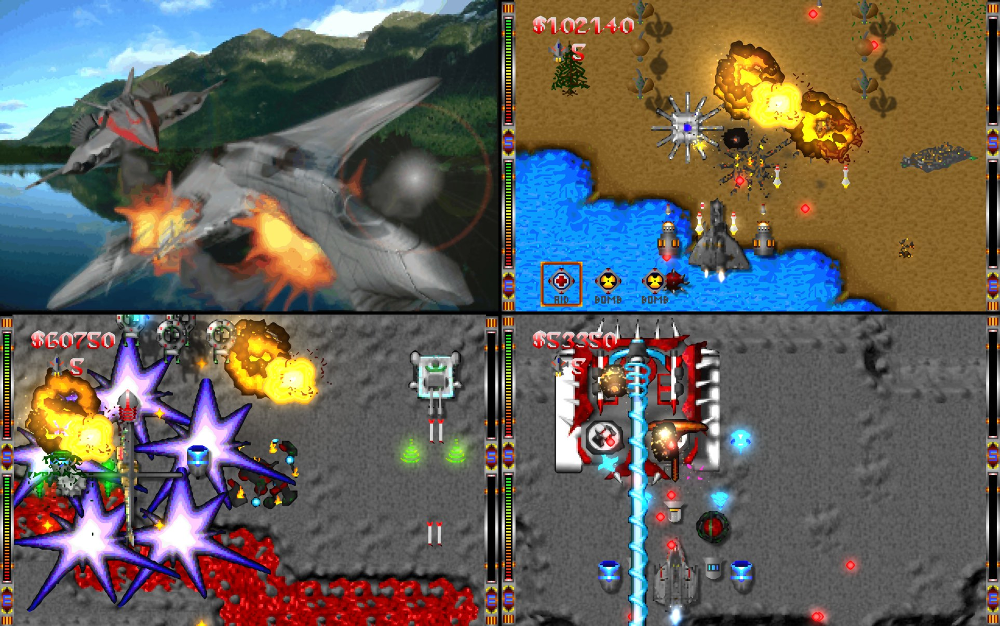

# Dark Planet Remastered



**▶ Play it in your browser: https://aimfeld.github.io/dark-planet/**

*Dark Planet* is a vertical-scrolling arcade shooter for DOS in the spirit of Raptor and Xenon 2. Three friends,
calling themselves HORSE Productions, wrote it in Turbo Pascal at the age of 16 to 18, worked on it for about a
year and a half, and released it on CD-ROM in October 1998. This project brings it back to life in the browser,
on desktops, phones and tablets:

- **Classic 1998**: the original as it was: 320×200, the original palette, sprites, sounds and rules.
- **Remastered 2026**: the same game with 4x graphics, smooth motion at the display's refresh rate, and effects.

Both play in German (the original) or English, alone or with two players, and you can switch between them at any
time.

## The original (1998)
There was no engine to start from. *Dark Planet* is a 16-bit real-mode DOS program, written in Turbo Pascal 7
for a 486, that talks to the VGA card, the Sound Blaster, the CD-ROM drive, the keyboard, the mouse and the
joystick itself or through small libraries. What survives is the 162 KB `DP.EXE`, the CD and a prototype.

### What's in it
- **A complete game.** Six levels in two episodes, each ending in a boss fight (an escort pair, a core with
  armoured parts, a segmented snake, a tank with turrets, a fortress, and the Golem). Over 70 enemy types with 43
  movement routines and their own guns and shot patterns, air and ground units with shadows, explosions, wrecks
  and bonus drops.
- **A shop and upgrade system.** Kills pay money, and the hangar's shop sells 4 more jets, 22 weapon pods, 3 shields, 3
  engines and 11 bonuses, with mounting rules per jet, selling back for half the price, and a money exchange
  between the players.
- **Two-player co-op**, with keyboard, mouse or joystick per player; player 2 can join from the hangar at any
  time.
- **Menus and texts**: animated 3D menu items, options, a save game, a story, a manual and credits in a scrolling
  text viewer, and a mission briefing before every level.
- **Memory management.** A DOS program lives in 640 KB of conventional memory. The game loads its 1,200 or so sprites
  (4.5 MB) and 59 sound effects (1 MB) into extended memory through the XMS driver at startup.
- **Hardware.** A keyboard interrupt handler of our own reads the keyboard controller, so several keys can be held
  at once. The mouse goes through the mouse driver, the joystick through the BIOS, and the CD audio through
  MSCDEX: the menus, the story, the levels, the bosses and the ending each have their own CD track, which the game loops. Sprites and scrolling run in VGA Mode X
  through the AniVGA library, and the sound effects are mixed for the Sound Blaster by SMIX.
- **All the content is homemade**: the 3D-rendered graphics, the intro and ending videos, the levels, the story
  and a 24-minute soundtrack, produced in [FastTracker 2](https://en.wikipedia.org/wiki/FastTracker_2) with our
  own electric guitar recordings and put onto the CD as 8 audio tracks.

About 90 KB of the compiled code (178 procedures) is our own; the rest is the libraries and Turbo Pascal's
runtime. The game grew out of our earlier programs, which are on the CD with their source: Wunibald's
*Cyberworms 2* and the *Sly* prototype of August 1997, 1,232 lines of Turbo Pascal with a scrolling level, a jet,
enemies and a boss. You can play the prototype too: https://aimfeld.github.io/dark-planet/sly.html.

### Our own ideas
The shop-and-upgrade design comes from Raptor and Xenon 2. What we added ([docs/influences.md](docs/influences.md)):
- **Flying high or low.** You switch altitude and can only hit or ram enemies at your own height; their shadows
  show where they are. Bonuses can only be picked up high, and the Autogun is the one weapon that hits both.
- **Saving costs money**, more every level, and there is one save slot.
- **A bonus inventory** of three slots: select a bonus, then fire it.
- **Co-op you join mid-game**, with money passed between the players.
- **The story and the humour**: Germanic villagers fly a crashed UFO back to the Dark Planet and bring the Golem
  down on Earth themselves, told with black humour, Swiss-German in-jokes, and nods to Lord of the Rings, Indiana
  Jones and the Simpsons.

### HORSE Productions
| | |
|---|---|
| HORSE Productions | Adrian (aka Wunibald), Urs (aka Üse), Jan |
| Game design & Graphics | Adrian, Jan, Urs |
| Programming | Adrian, Urs (tips: apw) |
| Videos | Jan |
| CD soundtrack & Guitar | Adrian |
| Story | Adrian, Urs, Sutter-Kane |
| Starring | Pferdi |

## The remake (2026)
The original source code is lost, so the game was reconstructed from `DP.EXE`: its 16-bit code disassembled in
Ghidra, routines matched against the AniVGA and SMIX sources and the prototype's source, and the results checked
against the original running in DOSBox-X. Every file format was decoded (sprites, levels, fonts, sounds,
pictures, videos), the soundtrack was found in the disc image as one long audio track and split again, and every
rule of the game is written down in [docs/gameplay-spec.md](docs/gameplay-spec.md) in 40 Hz ticks, each with the
address it came from.

- **One simulation, two renderers.** The game logic is a deterministic TypeScript port of the original routines
  at a fixed 40 Hz tick, shared by both modes, so they play the same. Classic draws into a 320×200 indexed
  framebuffer like AniVGA did; Remastered draws hq4x-upscaled graphics with PixiJS, interpolated between ticks.
- **Faithful, with fixes.** The original's bugs are fixed ([gameplay-spec §12](docs/gameplay-spec.md)), and a few
  usability changes are listed in §14. The original's cheat still works.
- **New**: an English translation (with re-rendered 3D menu items), gamepad and touch controls, two players on one
  keyboard, and an installable web app that plays offline.

Classic and Remastered are done; a free Steam release is in preparation. See [docs/PLAN.md](docs/PLAN.md) for the
roadmap and progress.

## Getting started
- **Play**: https://aimfeld.github.io/dark-planet/. Arrows move, X fires, C switches altitude, V selects a bonus,
  X+V uses it, R switches between Classic and Remastered. All controls: [docs/controls.md](docs/controls.md).
- **Run the remake locally**:
  ```sh
  cd game && npm install && npm run dev    # http://localhost:5173
  ```
  Tests, asset generation, screenshots, gameplay videos and deployment: [docs/development.md](docs/development.md).
- **Play the original** in DOSBox-X with its CD soundtrack: the 1998 game is in `original_source/`, see
  [docs/original-game.md](docs/original-game.md).

## Docs
- [docs/PLAN.md](docs/PLAN.md): goals, architecture, phases, decisions
- [docs/controls.md](docs/controls.md): controls for every input device
- [docs/development.md](docs/development.md): repository layout, building, testing, tools, deployment
- [docs/original-game.md](docs/original-game.md): the original game, DOSBox-X, asset extraction
- [docs/gameplay-spec.md](docs/gameplay-spec.md): the gameplay rules, in 40 Hz ticks
- [docs/re-notes.md](docs/re-notes.md): reverse-engineering findings
- [docs/file-formats.md](docs/file-formats.md): the original file formats
- [docs/influences.md](docs/influences.md): what Dark Planet borrowed and what it added
- [docs/translation-notes.md](docs/translation-notes.md): the German → English translation
